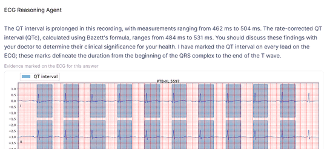

## About Me

I am a postdoctoral researcher at [KAIST AI](https://gsai.kaist.ac.kr/), working with [Prof. Edward Choi](https://mp2893.com). I received my Ph.D. in Artificial Intelligence from KAIST in 2026, also advised by Prof. Edward Choi, and my B.S. in Computer Science and Engineering from Korea University in 2021.

My research focuses on medical AI, especially for electrocardiograms (ECG) and electronic health records (EHR). I have worked on self-supervised representation learning for ECG signals, predictive modeling across heterogeneous EHR systems, and question answering datasets for clinical data. More recently, I have been building benchmarks to evaluate the clinical reasoning of multimodal large language models.

Building on my experience in constructing ECG datasets, I am currently working on agentic workflows for conversational ECG agents. Most of my research so far has been built on healthcare data, and my work on LLMs has centered on evaluation and benchmarking. Although I have not yet trained LLMs at scale, I am eager to gain experience in large-scale LLM training.

## Research Interests

- **Medical AI:** multimodal large language models for healthcare, clinical question answering, benchmarks for evaluating clinical reasoning
- **Electrocardiogram (ECG):** self-supervised representation learning, ECG question answering and interpretation, conversational ECG agents
- **Electronic Health Records (EHR):** predictive modeling across heterogeneous EHR systems, lab test outcome prediction, health data standards

## News

- **[Sept. 2026]** Our paper, [ECG-Reasoning-Benchmark](https://arxiv.org/abs/2603.14326), was accepted to the NeurIPS 2026 Evaluations and Datasets Track.
- **[Sept. 2026]** I was recognized as a Top Reviewer for the NeurIPS 2026 Evaluations and Datasets Track.
- **[Mar. 2026]** I joined KAIST AI as a postdoctoral researcher, continuing to work with [Prof. Edward Choi](https://mp2893.com).
- **[Feb. 2026]** I received my Ph.D. in Artificial Intelligence from KAIST.
- **[Apr. 2025]** Our paper, [LabTOP](https://arxiv.org/abs/2502.14259), was accepted to CHIL 2025 and received the Best Paper Award.
- **[Sept. 2023]** Our paper, [ECG-QA](https://arxiv.org/abs/2306.15681), was accepted to the NeurIPS 2023 Datasets and Benchmarks Track.
- **[Mar. 2022]** Our paper, [Lead-agnostic Self-supervised Learning for ECG](https://arxiv.org/abs/2203.06889), was accepted to CHIL 2022.

## Projects

<ol class="bibliography">

<li>

  

    <a href="./ecg-reasoning-agent/">
      <picture>
        <source srcset="./assets/img/ecg-reasoning-agent-thumb.jpg" media="(prefers-reduced-motion: reduce)" />
        
      </picture>
    </a>
  

  

    
<a href="./ecg-reasoning-agent/">ECG Reasoning Agent</a>

    
A conversational agent that answers questions about a 12-lead ECG and, when asked, highlights on the tracing the waves and intervals behind its answer. A live research demo is open to try.

    

      <a href="./ecg-reasoning-agent/" class="btn btn-sm z-depth-0 btn-page" role="button"><i class="fa-solid fa-globe" aria-hidden="true"></i>Project Page</a>
    

  

</li>

</ol>



## Education

- **Ph.D. in Artificial Intelligence**, KAIST, Mar. 2021 – Feb. 2026 Advised by [Prof. Edward Choi](https://mp2893.com)
- **B.S. in Computer Science and Engineering**, Korea University, Mar. 2017 – Feb. 2021


